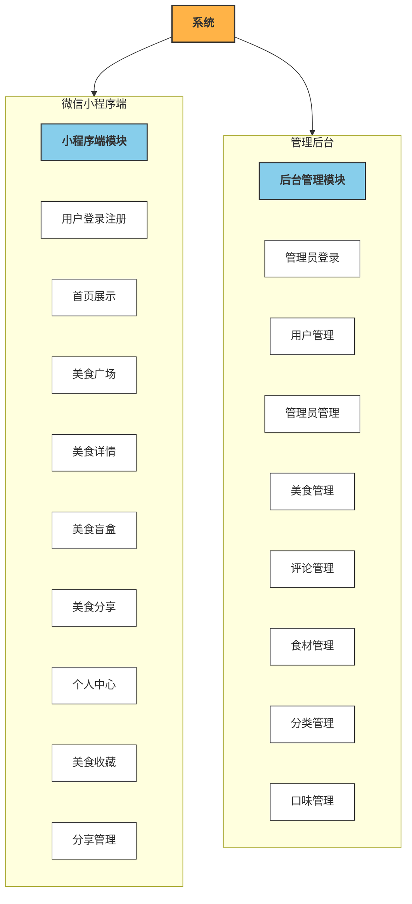

# 基于SpringBoot+Vue+微信小程序的美食分享交流系统的设计与实现

> 本文围绕基于SpringBoot、Vue及微信小程序的爱美食系统，详细介绍系统的设计思路与实现过程。

## 一、项目背景

- 为美食爱好者提供线上美食分享、查询、推荐与互动平台
- 解决美食信息分散、分享不便、缺乏统一管理与审核的问题
- 实现用户自主分享与管理员集中管理的一体化运营模式

## 二、功能模块介绍

系统分为微信小程序端与管理后台两大操作端，不同角色拥有对应操作权限。

| 系统端 | 角色 | 权限范围 |
| ---- | ---- | ---- |
| 微信小程序端 | 普通用户 | 登录注册、美食浏览、分享收藏、评论评分、个人信息管理 |
| 管理后台 | 管理员 | 登录验证、用户管理、内容管理、基础数据维护、系统配置管理 |

## 三、技术栈说明

前端：Vue、微信小程序

后端：JAVA、SpringBoot

数据库与中间件：MySql

## 四、核心模块介绍

### 微信小程序端

#### 普通用户

| 功能模块 | 功能说明 |
| ---- | ---- |
| 用户登录注册 | 账号注册、登录、身份验证 |
| 首页展示 | 系统公告展示、美食推荐展示 |
| 美食广场 | 美食分享列表展示、关键字查询、类别查询 |
| 美食详情 | 菜谱详情查看、美食收藏、点赞、评价、评分 |
| 美食盲盒 | 选择主食材、配菜、口味进行美食推荐 |
| 美食分享 | 发布个人美食内容、提交管理员审核 |
| 个人中心 | 个人信息修改、密码修改 |
| 美食收藏 | 收藏美食查看与管理 |
| 个人美食分享管理 | 个人发布美食内容管理 |

##### 界面展示：
**用户个人信息管理**

个人信息修改 支持用户查看并确认修改后的个人信息（姓名、头像），点击按钮提交修改

**美食（餐饮）服务模块**

美食展示与服务入口首页 展示最新美食信息，提供订餐、堂食预定入口，支持通过底部导航切换功能模块

**美食广场模块**

美食内容展示与浏览 支持美食关键词搜索、菜系分类筛选，展示用户发布的美食内容（含图片、名称、发布者信息），提供底部导航切换功能模块

**用户个人中心模块**

用户个人中心页面 展示用户发布的内容（含审核状态），提供编辑个人资料、删除/编辑发布内容、切换发布/点赞/收藏视图等操作入口

用户个人中心内容管理与信息展示 展示用户个人信息（头像、昵称），提供编辑资料、设置功能入口；管理用户发布、点赞、收藏的内容，当前可查看并删除点赞的内容

**餐饮推荐模块、公告通知模块、底部导航模块**

首页内容展示与导航入口 展示推荐餐饮内容（菜品卡片）、发布公告通知（含活动/福利信息），提供底部导航（首页、美食、餐盒、我的）切换入口

**美食内容管理**

修改美食信息 编辑并提交美食的名称、类别、口味、封面图片、简介、详情、食材及图片集等相关信息

**美食盲盒业务模块**

美食盲盒展示与操作入口页面 展示带有问号标识的美食盲盒视觉模型，提供盲盒相关功能（如开启盲盒）的视觉引导，底部导航栏支持切换至首页、美食、我的等模块

**美食详情模块**

展示美食详情 展示美食的名称、原料（主料、辅料、调料）、发布者、发布时间、口味标签，提供点赞、收藏功能，以及食材分类查看入口

展示美食详情及评论互动 提供美食的详细制作步骤、配菜信息，支持用户查看、发表、回复、删除评论

**用户运营模块（新用户注册福利公告）**

展示新用户注册福利公告详情 向用户展示新用户注册活动的具体福利信息，包括注册赠券、首单立减、积分加倍、会员特权等内容

**用户账号管理**

密码修改 提供旧密码、新密码、重复新密码的输入区域，通过点击确认修改按钮完成密码修改操作

**美食盲盒模块**

美食盲盒抽奖与推荐 用户可选择配料、配菜、口味，点击「盲盒抽奖」按钮获取推荐美食，同时展示美食推荐内容

美食盲盒抽奖（食材组合推荐） 支持用户选择主食材、配菜、口味，通过“盲盒抽奖”生成推荐美食（或随机生成符合条件的美食）

美食盲盒抽奖与推荐展示 提供食材标签、配菜选项、口味选项，支持用户选择后触发盲盒抽奖，同时展示美食推荐内容

**食材管理模块**

食材选择 支持食材搜索、已选食材展示及可选食材勾选操作，用于选择或管理食材

**用户认证模块**

用户登录 用户输入账号和密码，点击登录按钮完成身份验证以获取系统访问权限

用户注册 提供账号注册功能，包含账号、密码、确认密码输入项，注册操作按钮及已有账号登录跳转入口

### 管理后台

#### 管理员

| 功能模块 | 功能说明 |
| ---- | ---- |
| 管理员登录 | 管理员账号登录、身份验证 |
| 小程序用户管理 | 小程序端用户信息管理 |
| 管理员管理 | 系统管理员账号管理 |
| 美食管理 | 平台美食内容管理 |
| 用户评论管理 | 用户评论信息管理 |
| 食材管理 | 系统食材数据管理 |
| 美食分类管理 | 美食分类数据管理 |
| 口味管理 | 系统口味数据管理 |

##### 界面展示：
**美食管理模块下的食材管理子模块**

食材信息管理 支持食材信息的查询（按名称、类型筛选）、添加、删除操作，提供分页浏览食材列表的功能

**美食小程序的口味管理模块**

口味信息管理（增删改查+分页） 实现口味信息的查询、添加、修改、删除操作，支持分页浏览口味数据

**用户管理模块**

用户信息管理（列表展示与操作） 展示用户列表，支持按用户名搜索、重置、刷新，可执行添加、删除用户操作，对单个用户可修改信息，提供分页浏览功能

**美食管理模块下的分类管理子模块**

美食分类管理 对美食分类信息进行查询、新增、修改、删除及分页展示管理

**美食管理模块**

美食评价管理 提供美食评价的查看、删除、搜索筛选、分页浏览等功能，支持对评价数据的管理操作

**公告管理模块**

公告信息修改 对已存在的公告进行编辑，可修改公告标题、公告简介、上传/替换公告图片、编辑公告详细内容

公告信息管理 支持对公告信息进行查询、新增、修改、删除操作，展示公告的编号、标题、简介、图片、内容预览、所属分类及创建时间等信息

**后台管理系统登录模块**

用户身份认证（登录） 提供用户名和密码输入入口，验证用户身份以授权访问系统

**美食小程序-食材管理模块**

食材信息管理 支持食材信息的查询、新增、修改、删除操作，提供分页查看功能

**美食管理模块（美食小程序后台管理）**

美食信息管理与食材关联管理 管理美食的基本信息（编号、名称、分类、口味等），支持对美食记录的查询、添加、修改、删除操作，可管理关联食材，查看美食状态及详情，具备搜索、分页功能

## 五、主要业务流程

1. 用户打开微信小程序，进行注册或登录操作。

2. 用户进入首页，查看系统公告与推荐美食内容。

3. 用户进入美食广场，浏览美食列表或通过关键字、类别查询美食。

4. 用户查看美食详情，可进行收藏、点赞、评价、评分操作。

5. 用户使用美食盲盒功能，选择食材与口味获取推荐美食。

6. 用户编辑并发布美食分享内容，提交至管理员审核。

7. 审核通过后，美食内容在美食广场展示。

8. 用户在个人中心修改个人信息、密码，管理收藏与分享内容。

9. 管理员登录后台，进行用户、美食、评论、食材、分类、口味等数据管理。

## 六、项目拓展性

- 扩展美食视频分享、直播教学等多媒体功能
- 增加美食商城、食材购买、配送对接等电商模块
- 接入智能推荐算法，提升美食盲盒推荐精准度
- 拓展社区互动功能，如关注、粉丝、私信、话题圈子
- 支持多端适配，开发H5、PC端、APP等访问入口
- 增加数据统计、用户画像、运营分析等后台管理功能

## 📌 代码说明  
本仓库为毕业设计项目的 **后端核心代码部分**，以及完整的数据库脚本   
主要用于展示系统的业务设计思路与后端实现方式  
出于学习展示与版权保护考虑    
前端实现及部署配置未在本仓库中公开  

## 📮 项目交流  
本项目用于学习，项目展示  
如需项目完整功能演示、项目说明或技术交流  
请前往作者 GitHub 主页查看联系方式